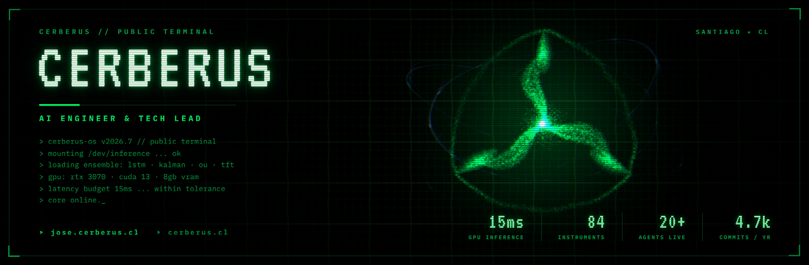
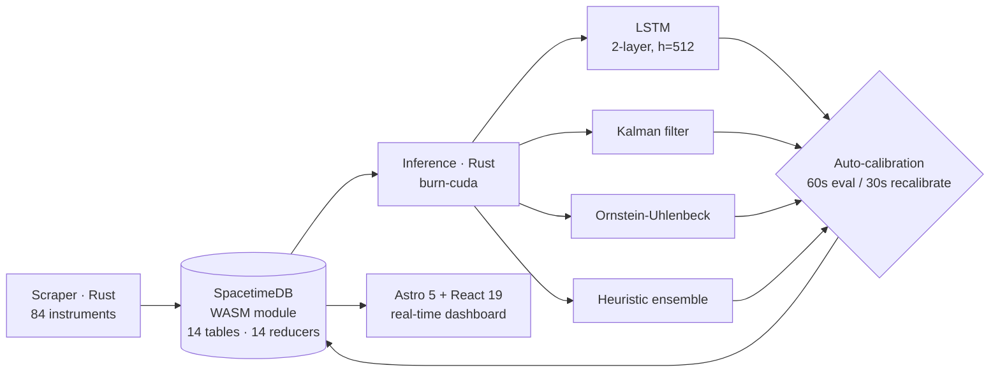
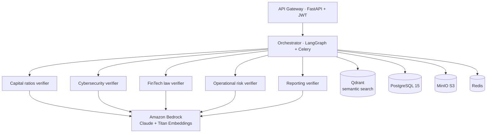
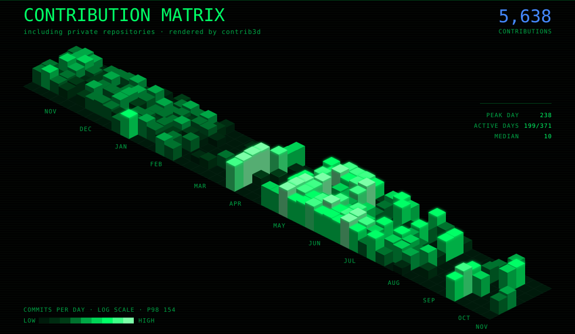

<div align="center">

<picture>
  <source media="(prefers-color-scheme: light)" srcset="assets/hero/v2/hero-light.webp">
  <source media="(prefers-color-scheme: dark)" srcset="assets/hero/v2/hero-dark.webp">
  
</picture>

**AI Engineer at Mallplaza** · CTO [@Cerberus Soluciones](https://cerberus.cl)<br>
B.Sc. Physics, Universidad de Chile · Santiago, Chile

`~15 ms` GPU inference · `84` instruments traded · `97` MCP tools · <!-- BEGIN:commits -->5.6k<!-- END:commits --> commits/year

[**Portfolio** ▸ jose.cerberus.cl](https://jose.cerberus.cl) · [**CV** ▸ PDF](https://l0rdbarcsacs.github.io/cv/Jose_Ignacio_Concha_Araya_CV.pdf) · [**Company** ▸ cerberus.cl](https://cerberus.cl) · [**LinkedIn** ▸ jose-ignacio-concha-araya](https://www.linkedin.com/in/jose-ignacio-concha-araya/)

</div>

---

```console
$ whoami
```

I build **AI systems that survive contact with production** — not demos. At Mallplaza I build
retail analytics and internal agent workflows with human handoff. At Cerberus Soluciones I ship
a multi-tenant market platform with 67 MCP tools, a Chilean regulatory warehouse with 2.25M
IFRS rows and 97 MCP tools, and a Rust market engine tracking 84 instruments at one-second
resolution. Physicist by training, systems engineer by trade: I lead the team, design the
architecture, and write the production code.

Most of my work lives in private repositories. The panels below are generated daily from the
GitHub API and include that private activity in aggregate — the code stays closed, the volume
doesn't.

---

## Systems I've shipped

<table>
<tr><td width="50%" valign="top">

### Cerberus Prescience
Multi-tenant market OS: a FIFO position book, per-leg valuation, market planes for macro,
breadth, sectors and systemic risk, and GPU forecasts with gamma exposure and risk-neutral
densities. **59 API routes · 67 MCP tools · 172 test modules**. Cold data ships with its
`basis_status` and reason, never a fabricated value.

`Python` `FastAPI` `TimescaleDB` `Chronos-2` `Astro 7` `MCP`

</td><td width="50%" valign="top">

### Cerberus Compliance
Chilean regulatory warehouse over CMF filings, IFRS statements, SII data and OFAC/UN/EU
sanctions. **22,935 essential facts · 2.25M IFRS rows · 97 MCP tools**. Telar answers
cite-or-refuse: when the corpus does not support a claim, it says so instead of guessing.
Ships as REST /v1, a typed Python SDK and an MCP server.

`Python` `FastAPI` `pgvector` `Qdrant` `Celery` `LangGraph`

</td></tr>
<tr><td width="50%" valign="top">

### Market-State Engine
A Rust scraper publishes **84 Chilean and international instruments every second** to
SpacetimeDB; a shared LSTM trains on `burn-cuda` and blends with Kalman, Ornstein-Uhlenbeck and
regime heuristics. Nowcasts a 300-second horizon and stops there — signals, not trades.

`Rust` `burn-cuda` `SpacetimeDB` `Astro 5` `LSTM`

</td><td width="50%" valign="top">

### Agent Foundry
One `company.yaml` declares roles, tools and escalation paths; the pipeline builds, evaluates
and deploys an ADK agent tree to Vertex AI Agent Runtime. Its first deployment, HAL 9000-CS,
orchestrates **9 specialists over a 1,265-document corpus**, with a deterministic protocol
auditor that uses no LLM and no network.

`google-adk` `Vertex AI` `A2A` `BigQuery` `Python`

</td></tr>
</table>

<details open>
<summary><b>Architecture — Market-State Engine</b></summary>



</details>

<details>
<summary><b>Architecture — Compliance review pipeline</b></summary>



</details>

---

## Live telemetry

<!-- BEGIN:stats -->
> Regenerated daily from the GitHub API, private repositories included in aggregate.
> **98.4% of my commits and pull requests land in private repositories** —
> 5,420 against 87 public, across 30 closed repos. The code stays closed, the volume does not.
<!-- END:stats -->

<div align="center">

<!-- BEGIN:contrib3d -->

<!-- END:contrib3d -->



</div>

---

## The rig

Everything above is built, trained and benchmarked on hardware I own and tune myself.

| Node | Spec | Role |
|---|---|---|
| **CERBERUS-MAINFRAME** | Ryzen 7 7700 · RTX 3070 8 GB · 32 GB DDR5-6400 · 4 TB NVMe · Arch Linux + Hyprland | ML training, GPU inference, daily driver |
| **CERBERUS-HPC** | IBM X6 3850 · 48 vCPU · 512 GB RAM | Local LLM cluster — vLLM + RAG + hybrid web search |
| **CERBERUS-MOBILE** | ThinkPad T14 · i7-1165G7 · 32 GB · Arch Linux | Remote development |

`CUDA 13/12.x` `cuDNN` `eBPF` `ZFS` `SLURM` `Kubernetes` `Docker Swarm` `Terraform` `Ansible`

---

## Writing

Long-form essays on AI governance, ontological auditing and infrastructure. Published in
Spanish at [jose.cerberus.cl](https://jose.cerberus.cl).

<!-- BEGIN:writing -->
- **[Mythos, Roko y la zona ciega: el test epistémico que le hice a HAL 9000-CS](https://jose.cerberus.cl/blog/mythos-roko-test-epistemico/)** · <sub>2026-05-06</sub>
- **[Autoresearch mar14: Cuando HAL Optimizó un GPT Mientras Dormías](https://jose.cerberus.cl/blog/autoresearch-experimento-mar14/)** · <sub>2026-03-14</sub>
- **[Génesis: Cuando las Máquinas Comenzaron a Hablarme](https://jose.cerberus.cl/blog/genesis-fascinacion-inteligencia-artificial/)** · <sub>2026-02-02</sub>
- **[La Emergencia Silenciosa: Por Qué Su IA Corporativa Necesita Auditoría Ontológica](https://jose.cerberus.cl/blog/auditoria-ontologica-ia-empresarial/)** · <sub>2025-07-17</sub>
<!-- END:writing -->

---

<div align="center">

### Enter the mainframe

**[▸ l0rdbarcsacs.github.io](https://l0rdbarcsacs.github.io)** — this account rendered in WebGL:
the contribution calendar extruded into a city, the language distribution, and the systems
above in orbit. Static by construction, data baked from the API at deploy time.
[Source](https://github.com/l0rdbarcsacs/l0rdbarcsacs.github.io).

**[▸ jose.cerberus.cl](https://jose.cerberus.cl)** — a CRT-mainframe WebOS in Astro and raw
WebGL2: a living neural-network background, fourteen desktop apps, and a plain-text mode.

<!-- BEGIN:footer -->
<sub>Regenerated Nov 23, 2026, 11:02 a.m. · Santiago, Chile · every panel on this page is produced by a workflow in this repository</sub>
<!-- END:footer -->

</div>
